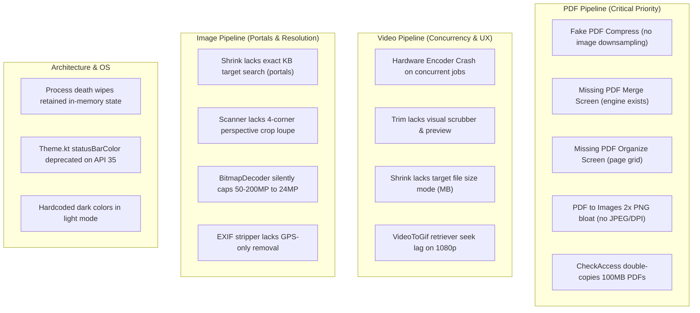

> **Status update (2026-10-17, read first):** this handover is historical. The app is now named
> **Apparat** (package still `com.omniforge.app`), compile/target SDK 36, version 1.1.0 (code 3),
> R8 enabled for release. Nearly every issue in section 3 below has been fixed since; the
> current list of done/open work is the "Current status" section of `AUDIT_2026-10-17.md`.

# Handover Guide & Code Audit for Claude — Digital Pocket Knife

**Date:** 2026-10-17  
**App Name:** Digital Pocket Knife (Package: `com.omniforge.app`)  
**Current Branch:** `master`  
**Head Commit:** `cf2f310`  
**Test Suite:** 52 passing unit tests (`./gradlew :app:testDebugUnitTest --rerun-tasks`)  
**Primary Reference Files:**
- [`FIX_PLAN.md`](./FIX_PLAN.md) — Master product backlog and status tracker.
- [`GEMINI_CHANGES.md`](./GEMINI_CHANGES.md) (and [`Gemini changes.md`](./Gemini%20changes.md)) — Complete technical changelog of Batches 1–11 with 36 Claude audit points.
- [`PLAY_STORE_GUIDE.md`](./PLAY_STORE_GUIDE.md) — Google Play Console release automation and signing playbook.

---

## 1. Project Invariants & Non-Negotiables

When taking over the codebase, adhere strictly to these constraints:

1. **100% Offline & Private:**
   - There are **no network permissions** in `AndroidManifest.xml` (`android.permission.INTERNET` is absent).
   - Never add cloud services, analytics, telemetry, or remote API calls. All processing is 100% on-device.
2. **Brand & Identity:**
   - The user-facing name is **Digital Pocket Knife**.
   - Keep the package identifier `com.omniforge.app`. Changing `applicationId` breaks user upgrade paths and existing SharedPreferences.
   - Discard/ignore experimental "Apparat" design files in the repo root; keep the established dark-first Material 3 theme.
3. **Build Environment & Toolchain:**
   - JDK 17 must be exported for all builds:
     ```bash
     export JAVA_HOME=$JAVA_HOME
     ```
   - Target SDK: 35 (Android 15), Compile SDK: 35, Min SDK: 29 (Android 10+).
   - Engine choices decided: **AndroidX Media3 Transformer** for video/audio (FFmpeg-Kit completely removed); **PDFBox-Android** for PDF manipulation; **Coil** for image loading/previews; pure Kotlin for custom algorithms.

---

## 2. Work Completed to Date (Batches 1–11)

Gemini has resolved all high-severity, app-breaking bugs and self-contained quick wins without regressions:

| Batch | Commit | Focus Areas | Key Deliverables |
|---|---|---|---|
| **Batch 1** | `2af848f` | 1B.5, 1B.8, 1B.10, 1C.4, 1D.2, 1D.3 | JPEG white canvas compositing for transparency; shrink target format encoding; A4 PDF scaling with margins; centralized `DOWNLOAD_SUBFOLDER = "DigitalPocketKnife"`; FGS `onTimeout` safety for Android 15; 24dp monochrome `ic_stat_notify`. |
| **Batch 2** | `10357f7` | 1B.1, 1B.2, 1B.3, 1D.2, 1D.3 | PDF split chunking & strict range validation UI; honest PDF compression reporting without destructive overwrites; persistent notification permission in `AppSettings`; standardized tool titles. |
| **Batch 3** | `feb5b2d` | 1C.1, 1C.2, 1B.7, 1B.11 | Dynamic Compose theme recomposition (`themeRecomposeTrigger`); default save mode honored; "Replace Original" format-mismatch protection; lossless EXIF stripping for JPEG (`ExifInterface`) preserving orientation. |
| **Batch 4** | `35c4f6d` | 1C.5, 1D.2, 1D.3 | Activity leak prevention in `ToolJobs` via `appContext`; `singleTop` notification tap navigation without backstack destruction; safe startup temp cache cleanup (`cleanStaleCacheDir`); WAV IEEE float PCM downsampling to 16-bit; README update. |
| **Batch 5** | `aeb768a` | 1D.2, 1D.3, 3B | `NonCancellable` file downloads in `ResultCard`; incoming share-in protection banner during busy jobs; animated image detection notice (`AnimatedImageDrawable`); AudioExtract expanded to `audio/*` inputs; VideoToGif start offset slider. |
| **Batch 6** | `3d66375` | 1D.2, 3D | Single-pass multi-digest `UtilityEngine.calculateChecksums` (MD5/SHA-1/SHA-256/SHA-512) in `ToolJobs` with case-insensitive compare; QR Studio 50x bulk `setPixels` speedup; Base64 URL-safe toggle & resilient fallback; Media3 OpenGL HDR-to-SDR tone-mapping; encryption honesty notices. |
| **Batch 7** | `85e8fa0` | 2.5, 2.7, 3B, 3D | Tokenized multi-word search across 20 tools with comprehensive keyword metadata; PDF unlock encryption detection & copy cleanup; JSON line/column error reporting; dynamic timestamped output PDF naming; output APK naming (`DigitalPocketKnife-debug.apk`). |
| **Batch 8** | `964f437` | 2.8, 3B, 3D, 3F | Comprehensive system share sheet & `ACTION_VIEW` intent routing for PDFs, video, image, text, and `*/*`; rotation-safe `initialUri` handling; QR Studio templates (Wi-Fi, UPI, vCard); Base64 binary magic-byte detection (PDF, PNG, JPG, GIF, WebP) with direct Downloads export. |
| **Batch 9** | `78b2521` & `5bb9f4d` | 3B | ResultCard 2-tier ergonomic layout with full-width Save, side-by-side Open (`AutoMirrored.OpenInNew`) and Share, and Coil thumbnail preview; lossless WebP (`WEBP_LOSSLESS` on API 30+); EXIF Stripper reassurance card with `VerifiedUser`; Palette Extractor retained polish & HEX/RGB display; video share-in routing. |
| **Batch 10** | `bde6adc` & `a5f97be` | 3B, 3C, 3D, 3E, 3F | Android `ACTION_PROCESS_TEXT` system integration via 4 activity-aliases (QR, JSON, Base64, Hash); Photo Shrink quick presets & continuous slider; video metadata inspection (resolution, duration, size); ResultCard `ToolChainAction` assist chips; `calculateTextChecksums`; version bump to 1.0.1 (code 2); 49 passing unit tests. |
| **Batch 11** | `3673b6e` & `cf2f310` | 1C.3, 3B, 3C, 3D | Dynamic Quick Actions & Android launcher shortcuts (`ShortcutManagerCompat.setDynamicShortcuts`) synced with Settings; removed static shortcuts manifest meta-data; centralized `ALL_TOOLS`; deep link scheme isolation (`uri.scheme != "dpk"`); HashVerifier auto-run chaining fix; AudioExtract metadata & pure-audio duration fallback; DocumentScan preview & shrink chaining; VideoToGif frame count / file size estimate; 52 passing unit tests. |

---

## 3. Deep Code Audit Report: Broken, Incomplete & Risky Areas

This section catalogs every known defect, missing screen, and architectural vulnerability currently remaining in the codebase.



### 3.1 PDF Pipeline

#### 1. PDF Compression Does Not Actually Compress Images (`PdfEngine.kt:compressPdf`)
- **Location:** [`PdfEngine.kt:61-80`](./app/src/main/java/com/omniforge/app/engine/pdf/PdfEngine.kt#L61-L80) and [`PdfShrinkScreen.kt`](./app/src/main/java/com/omniforge/app/feature/pdf/PdfShrinkScreen.kt).
- **The Problem:** `compressPdf` loads the `PDDocument` and immediately invokes `doc.save(output, CompressParameters.DEFAULT_COMPRESSION)`. It accepts `imageQuality: Float`, but **never uses it**. 
- **Impact:** In standard PDFs, text and vector streams are already Flate-compressed. Over 90% of file size in scanned PDFs or photo-heavy documents comes from embedded `PDImageXObject` resources. Running "Compress PDF" leaves image streams 100% untouched. Output files are often identical in size or slightly larger due to PDFBox re-serializing metadata.
- **Blueprint for Claude:**
  1. Iterate over all pages: `doc.pages.forEach { page -> ... }`.
  2. Inspect page resources: `page.resources?.xObjectNames?.forEach { cosName -> ... }`.
  3. When `page.resources.getXObject(cosName) is PDImageXObject`, extract the image.
  4. If image width/height exceeds target DPI (e.g. 150 DPI for standard, 96 DPI for strong), downsample the bitmap using `Bitmap.createScaledBitmap`.
  5. Re-encode to JPEG using `JPEGFactory.createFromImage(doc, scaledBitmap, quality)`.
  6. Replace the old XObject in `page.resources.put(cosName, newImage)`.
  7. Add a "Rasterize & Rebuild" fallback mode for pure scanned PDFs using `PdfRenderer` + `PdfEngine.imagesToPdf`.
  8. Provide portal upload presets ("Under 2 MB / 1 MB / 500 KB / 200 KB").

#### 2. Missing PDF Merge Screen (`PdfMergeScreen.kt`)
- **Location:** [`PdfEngine.kt:mergePdfs`](./app/src/main/java/com/omniforge/app/engine/pdf/PdfEngine.kt#L236-L260) exists, but there is no UI.
- **The Problem:** Merging PDFs is one of the two most requested flows for the target user (Indian business owner combining bills, invoices, KYC docs). The backend method is already written and tested, but users have no screen to access it.
- **Blueprint for Claude:**
  1. Create `app/src/main/java/com/omniforge/app/feature/pdf/PdfMergeScreen.kt`.
  2. Implement multi-document picker using `ActivityResultContracts.OpenMultipleDocuments()`.
  3. Build a reorderable list of selected PDFs (drag handle, filename, page count, file size, remove button).
  4. Include "+ Add More PDFs" button (appends without replacing existing list).
  5. Use `PdfPasswordGate` per document if any picked PDF is encrypted.
  6. Wire `"pdf_merge"` route into `MainActivity.kt` and `HomeScreen.kt`.

#### 3. Missing Organize Pages Screen (`PdfOrganizeScreen.kt`)
- **Location:** Needs new screen and visual thumbnail grid.
- **The Problem:** Users cannot delete unwanted pages, rotate upside-down scanned pages, or reorder pages within a single PDF document.
- **Blueprint for Claude:**
  1. Implement `PdfPageGrid` using Android's native `PdfRenderer` on `Dispatchers.IO`.
  2. Render lightweight thumbnails (~200px wide) lazily with an LRU memory cache.
  3. Support page selection, deletion, clockwise rotation (updating `PDPage.rotation = (rotation + 90) % 360`), and drag-to-reorder.

#### 4. PDF to Images Memory & Storage Bloat (`PdfToImagesScreen.kt`)
- **Location:** [`PdfToImagesScreen.kt`](./app/src/main/java/com/omniforge/app/feature/pdf/PdfToImagesScreen.kt) and [`PdfEngine.kt:pdfToImages`](./app/src/main/java/com/omniforge/app/engine/pdf/PdfEngine.kt#L130-L160).
- **The Problem:** Renders all pages at a hardcoded 2x scale (`2.0f`) to uncompressed PNG. A 30-page PDF can easily generate 300+ MB of PNG files in cache, risking OOM and device storage exhaustion.
- **Blueprint for Claude:**
  1. Add format toggle: JPEG (default, 85% quality) vs PNG.
  2. Add resolution presets: Share (150 DPI), Print (300 DPI).
  3. Allow page range selection (don't force converting all pages).

#### 5. PDF Password Gate Double File Copy
- **Location:** [`PdfEngine.kt:checkAccess`](./app/src/main/java/com/omniforge/app/engine/pdf/PdfEngine.kt#L30-L55).
- **The Problem:** When a PDF is selected, `checkAccess` copies the entire file from ContentResolver to `cache/pdfbox/temp_check_*.pdf` to test encryption and page count. Then, when the user taps "Run", the tool copies the original content URI a second time. On a 100 MB PDF, this copies 200 MB to disk.
- **Blueprint for Claude:** Store the first cached temp file in the session state and reuse its file descriptor directly for processing.

---

### 3.2 Video Pipeline

#### 1. Hardware Video Encoder Exhaustion on Concurrent Jobs (Crash Risk)
- **Location:** [`ToolJobs.kt`](./app/src/main/java/com/omniforge/app/core/jobs/ToolJobs.kt) and [`VideoEngine.kt:runTransformer`](./app/src/main/java/com/omniforge/app/engine/video/VideoEngine.kt#L320-L400).
- **The Problem:** `ToolJobs.launch` permits any screen to launch an independent background job. If a user starts video shrink in `VideoShrinkScreen` and then starts video convert in `VideoConvertScreen`, two Media3 Transformer pipelines initialize hardware video encoders concurrently.
- **Risk:** Most mobile SoCs (Snapdragon, MediaTek, Exynos, Tensor) only expose 1 or 2 hardware `MediaCodec` video encoder instances. Exceeding this limit crashes Transformer immediately with `MediaCodec.CodecException: ERROR_INSUFFICIENT_RESOURCE` or `ENCODER_INIT_FAILED`.
- **Blueprint for Claude:**
  - Create a video encode queue or `Mutex` in `ToolJobs` or `VideoEngine`.
  - If a video job is already running, subsequent video jobs enter a queued state (`ProcessState.Queued("Waiting for previous video encode to finish…")`) and execute sequentially.

#### 2. Video Trim Scrubber & Frame Preview Missing
- **Location:** [`VideoTrimMuteScreen.kt`](./app/src/main/java/com/omniforge/app/feature/video/VideoTrimMuteScreen.kt).
- **The Problem:** Users must manually type start and end seconds into numeric text fields without any video scrubber or playback preview to see where the cut occurs.
- **Blueprint for Claude:**
  - Embed Media3 `PlayerView` / `ExoPlayer` bounded preview.
  - Implement a dual-handle range slider mapped to playback position.

#### 3. Video Shrink Target File Size Mode
- **Location:** [`VideoShrinkScreen.kt`](./app/src/main/java/com/omniforge/app/feature/video/VideoShrinkScreen.kt).
- **The Problem:** Only offers fixed resolution factors and bitrate chips. Users cannot say "Compress to 16 MB for WhatsApp" or "Compress to 25 MB for Gmail".
- **Blueprint for Claude:**
  - Calculate exact video bitrate: `targetBitrate = ((targetBytes - (audioBitrate * durationSec / 8)) * 8) / durationSec`.
  - Pass calculated `videoBitrate` into Media3 Transformer's `DefaultEncoderFactory`.

#### 4. Video to GIF Frame Extraction Seek Lag
- **Location:** [`VideoEngine.kt:videoToGif`](./app/src/main/java/com/omniforge/app/engine/video/VideoEngine.kt#L250-L310).
- **The Problem:** Uses `MediaMetadataRetriever.getFrameAtTime(timeUs, OPTION_CLOSEST)` in a tight loop. Because `OPTION_CLOSEST` seeks backwards to the nearest keyframe and decodes forward for each frame, processing a 5-second 1080p clip at 15 fps takes 30–60 seconds.
- **Blueprint for Claude:** For long-term optimization, decode sequentially using `MediaExtractor` + `MediaCodec` into an `ImageReader` / Surface.

---

### 3.3 Image Pipeline

#### 1. Photo Shrink Target File Size (KB) Search Mode (Critical for Indian Portals)
- **Location:** [`ImageShrinkScreen.kt`](./app/src/main/java/com/omniforge/app/feature/image/ImageShrinkScreen.kt) and [`ImageEngine.kt:shrinkImage`](./app/src/main/java/com/omniforge/app/engine/image/ImageEngine.kt#L45-L95).
- **The Problem:** Indian portal uploads (UPSC, SSC, State PSC, PAN, Aadhaar, EPFO) strictly enforce file size limits like "between 20 KB and 50 KB" or "max 100 KB". If a file is 101 KB, the portal rejects it. Currently, users have to manually guess slider values and re-run multiple times.
- **Blueprint for Claude:**
  - Implement `suspend fun shrinkToTargetSize(context: Context, uri: Uri, targetKb: Int): File`:
    1. Perform a binary search on JPEG quality (`minQ = 30`, `maxQ = 95`).
    2. If quality 30 still exceeds `targetKb`, step down max dimensions by 15% and repeat.
    3. Guarantees output is $\le targetKb$ in 3–5 fast in-memory compress iterations.

#### 2. Document Scanner Lacks 4-Corner Perspective Crop Loupe & Camera Capture
- **Location:** [`DocumentScanScreen.kt`](./app/src/main/java/com/omniforge/app/feature/image/DocumentScanScreen.kt) and [`ImageEngine.kt:enhanceDocumentScan`](./app/src/main/java/com/omniforge/app/engine/image/ImageEngine.kt#L125-L160).
- **The Problem:** It only has global contrast/brightness sliders. When users take a photo of a document on a table, it has perspective distortion and shadows.
- **Blueprint for Claude:**
  - Add camera capture via `ActivityResultContracts.TakePicture()`.
  - Add interactive 4-corner quadrilateral crop handles with a circular magnification loupe during drag.
  - Apply quadrilateral perspective warp via `android.graphics.Matrix().apply { setPolyToPoly(srcCorners, 0, dstRect, 0, 4) }` on a high-res canvas.
  - Implement Sauvola or Bradley adaptive integral-image thresholding to eliminate uneven lighting and shadows.

#### 3. Silent 24MP Downscaling in BitmapDecoder
- **Location:** [`BitmapDecoder.kt:decodeBitmap`](./app/src/main/java/com/omniforge/app/engine/image/BitmapDecoder.kt#L30-L65).
- **The Problem:** Caps image resolution at 24 MP (12 MP on low-RAM). When a user inputs a 50 MP, 108 MP, or 200 MP camera photo into **Photo Format Convert** or non-JPEG **EXIF Stripper**, the image is downscaled without warning.
- **Blueprint for Claude:** Display an honest notice in `ResultCard` ("Scaled to 24MP to fit device memory").

#### 4. EXIF Stripper Lacks GPS-Only Removal
- **Location:** [`ExifStripperScreen.kt`](./app/src/main/java/com/omniforge/app/feature/image/ExifStripperScreen.kt).
- **The Problem:** It is all-or-nothing. Users often want to remove private location coordinates (`TAG_GPS_*`) while preserving camera parameters (f-stop, shutter speed, ISO, focal length).

---

### 3.4 Architecture & Lifecycle

#### 1. In-Memory `retained` Store Wiped on Process Death
- **Location:** [`CommonComponents.kt:retained`](./app/src/main/java/com/omniforge/app/core/ui/CommonComponents.kt#L45-L85).
- **The Problem:** `retained` uses an in-memory `ConcurrentHashMap`. While it survives screen rotations, it **does not survive Android process death**. If the OS kills the process in the background, reopening the app loses the active job result and clears the UI state.
- **Blueprint for Claude:**
  - Migrate screen state to Jetpack `ViewModel` + `SavedStateHandle`.
  - Or persist active job metadata (`jobKey`, `selectedUri`, `outputFile`, `processState`) in a lightweight SharedPreferences session store.

#### 2. Deprecated Window Insets APIs in `Theme.kt`
- **Location:** [`Theme.kt:110-111`](./app/src/main/java/com/omniforge/app/core/theme/Theme.kt#L110-L111).
- **The Problem:** `window.statusBarColor` and `window.navigationBarColor` are deprecated on API 35 (Android 15) and ignored due to edge-to-edge enforcement.
- **Blueprint for Claude:** Clean up with `WindowInsetsControllerCompat` and modern Compose `enableEdgeToEdge()`.

#### 3. Dark Mode Color Hardcoding
- **Location:** [`CommonComponents.kt`](./app/src/main/java/com/omniforge/app/core/ui/CommonComponents.kt) and [`HomeScreen.kt`](./app/src/main/java/com/omniforge/app/feature/home/HomeScreen.kt).
- **The Problem:** Several components hardcode dark hex colors (`DarkSurfaceElevated`, `Color(0xFF1E1E1E)`, `TextPrimary = Color(0xFFF5F5F7)`). When switching to Light Theme in Settings, parts of the UI remain dark or show low-contrast text.
- **Blueprint for Claude:** Replace raw color constants with `MaterialTheme.colorScheme` tokens.

---

## 4. Priority Roadmap for Claude

Here is the recommended execution sequence for Claude:

```
[Phase 2: PDF Powerhouse]
  ├── Task 1: Real PDF Compression (PDImageXObject downsampling & portal presets)
  ├── Task 2: Build PdfMergeScreen (multi-PDF picker, reorder list, password handling)
  ├── Task 3: Build PdfPageGrid & PdfOrganizeScreen (reorder, rotate, delete pages)
  └── Task 4: PdfToImages JPEG format & DPI selection

[Phase 3: Image & Video Upgrades]
  ├── Task 5: Photo Shrink exact target file size (KB) binary search
  ├── Task 6: Video encoding FIFO concurrency queue in ToolJobs (prevent hardware crashes)
  ├── Task 7: Video Shrink target file size (MB) mode
  ├── Task 8: Document Scanner 4-corner perspective crop loupe & camera capture
  └── Task 9: Video Trim visual scrubber & frame preview

[Phase 4: Architecture, OS & Play Store]
  ├── Task 10: State persistence for Process Death survival (ViewModel / SavedStateHandle)
  ├── Task 11: Theme tokenization (light mode contrast pass)
  └── Task 12: R8 ProGuard rules validation & Play Store AAB release testing
```

---

## 5. Critical Architecture Guardrails & Gotchas (10 Rules)

Claude must keep these lessons in mind to prevent regressions:

1. **Launcher Shortcuts Max Limit:** Android enforces a strict limit of 4 shortcuts per app. Never re-add static shortcuts to `AndroidManifest.xml` (`<meta-data android:name="android.app.shortcuts" ...>`), or dynamic shortcuts will fail with quota exceptions.
2. **Deterministic Shortcut Ordering:** SharedPreferences `getStringSet` returns an unordered set. Always sort/filter against `ALL_TOOLS.filter { it.id in targetIds }.take(4)` to prevent shortcuts jumping around.
3. **Media3 OpenGL Tone-Mapping:** Smartphone cameras record 10-bit HDR (HDR10/HLG). Whenever re-encoding video, always wrap the media item in `Composition.Builder(EditedMediaItemSequence(item)).setHdrMode(Composition.HDR_MODE_TONE_MAP_HDR_TO_SDR_USING_OPEN_GL)`. Omission causes encoder initialization crashes or washed-out video.
4. **PDFBox Temp File Storage:** Always load PDFs using `PDDocument.load(file, password, MemoryUsageSetting.setupTempFileOnly())`. Defaulting to main memory triggers fatal OutOfMemoryErrors on 100+ page scans.
5. **Coil Memory Bounding:** In Jetpack Compose scrollable columns (`verticalScroll`), never call Coil `AsyncImage` without an explicit `.height(...)` modifier and `ImageRequest.Builder.size(coil.size.Size(512, 512))`. Unbounded calls decode full 50–108 MP bitmaps into RAM, crashing the app.
6. **FileProvider Content URIs:** When chaining tools via `ToolChainAction` or sharing files, always use `FileUtils.getContentUri(context, file)` (`content://com.omniforge.app.fileprovider/...`). Passing raw `file://` URIs triggers `FileUriExposedException` on Android 10+.
7. **Atomic Intent Data and Type:** In `FileUtils.openFile`, always call `intent.setDataAndType(contentUri, mimeType)`. Calling `intent.data = ...` followed by `intent.type = ...` clears the data URI in Android's intent implementation.
8. **ACTION_PROCESS_TEXT Activity Alias Resolution:** In `MainActivity.kt`, always inspect `intent.component?.className?.endsWith("ProcessText...")`. Android runtime returns canonical fully-qualified class names, never manifest-relative strings.
9. **NonCancellable File Saving:** Always wrap `onSaveToDownloads` in `withContext(Dispatchers.IO + NonCancellable)`. If a user presses back or navigates while saving a 200 MB file, a standard coroutine cancels midway and leaves orphan bytes.
10. **Retained Store Lifecycle:** The in-memory `retained` store only survives configuration changes (rotation). Do not rely on it for critical persistent state across process death.

---

## 6. Developer Commands Reference

```bash
# 1. Setup Java 17
export JAVA_HOME=$JAVA_HOME

# 2. Run All 52 Unit Tests
./gradlew :app:testDebugUnitTest --rerun-tasks

# 3. Build Debug APK (outputs app/build/outputs/apk/debug/DigitalPocketKnife-debug.apk)
./gradlew assembleDebug

# 4. Build Release Android App Bundle (.aab)
./build-release.sh

# 5. Fastlane Automated Testing & Building
bundle exec fastlane test
bundle exec fastlane build_bundle
```
