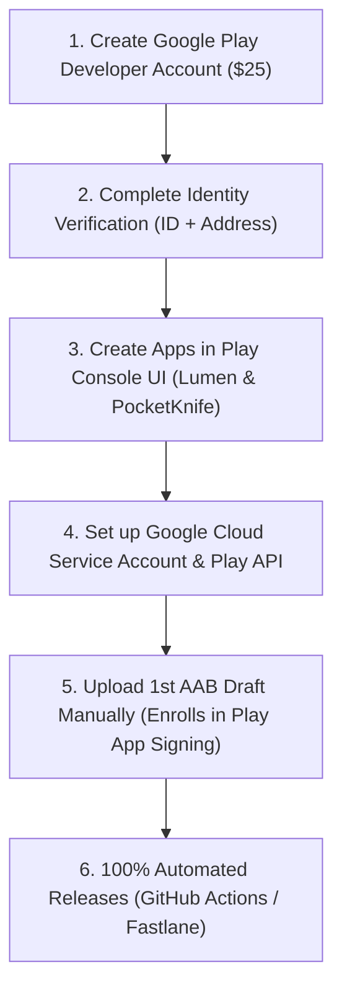

# Google Play Store Publishing & Automation Playbook
**Apps Covered:**
1. **Lumen Android** (`com.vedant.lumen`) — Media Player
2. **Digital Pocket Knife** (`com.omniforge.app`) — Offline Swiss-Army Utility Toolkit

---

## 1. What We Have Built & Configured in Your Projects

Both of your projects are now fully wired and verified to build release Android App Bundles (`.aab`):

| Component | Purpose | Location |
| :--- | :--- | :--- |
| **`signingConfigs` in `build.gradle.kts`** | Standardized production signing supporting local `keystore.properties` & CI environment variables with graceful fallback | [`Lumen build.gradle.kts`](../Lumen-Android/app/build.gradle.kts), [`PocketKnife build.gradle.kts`](./app/build.gradle.kts) |
| **Keystore Generator** | Automated shell script that creates 2048-bit RSA keystores and sets up `keystore.properties` | [`generate-keystore.sh`](../Lumen-Android/scripts/generate-keystore.sh) |
| **Release Bundler** | Local test & build script for compiling production `.aab` | [`build-release.sh`](../Lumen-Android/build-release.sh) |
| **GitHub Actions CI/CD** | Automated pipeline triggered on Git tags (`v*`) or manual dispatch button with track selector (`internal`, `alpha`, `beta`, `production`) | [`.github/workflows/deploy-play-store.yml`](../Lumen-Android/.github/workflows/deploy-play-store.yml) |
| **Fastlane Pipeline** | CLI automation for local or custom runners | [`fastlane/Fastfile`](../Lumen-Android/fastlane/Fastfile) |
| **Secret Protection** | `.gitignore` rules shielding `.keystore`, `.jks`, `keystore.properties`, and service account JSON files from accidental git commits | [`.gitignore`](../Lumen-Android/.gitignore) |

Both apps have been test-built and confirmed to generate valid `.aab` bundles.

---

## 2. Google Play Prerequisites (First-Time Developer Setup)

Because you haven't published before, Google enforces specific legal, identity, and developer console steps before any API or tool can publish for you.



### Step 2.1: Developer Account Registration & Identity
1. Go to [Google Play Console](https://play.google.com/console/signup).
2. Choose account type:
   - **Personal Account**: Requires a $25 one-time fee + Government ID + Phone number + Proof of address.
   - **Organization Account**: Requires a $25 fee + official D-U-N-S number (Dun & Bradstreet).
3. Complete the identity verification prompt.

> [!IMPORTANT]
> **The 20-Tester Rule for Personal Accounts**:
> If your Google Play Console personal account was created after **November 13, 2023**, Google requires you to run a **Closed Test** with at least **20 testers opted-in for 14 continuous days** before you can apply for Production access.
> - **Internal Testing track** is exempt from this rule (up to 100 testers, available instantly with zero waiting).
> - Automation works for all tracks (`internal`, `alpha`/closed, `beta`/open, `production`).

---

## 3. Creating the Apps in Google Play Console (Mandatory 1st Step)

> [!WARNING]
> Google Play Developer API **cannot** create new apps out of thin air. You must create the initial app container in the Play Console web UI once.

For each app:
1. Log in to [Google Play Console](https://play.google.com/console).
2. Click **Create app** (top-right).
3. Fill in the app details:
   - **App 1**:
     - App name: `Lumen` (or your preferred public title)
     - Default language: English (United States)
     - Type: App | Free
     - Package Name: will automatically bind to `com.vedant.lumen` upon first upload.
   - **App 2**:
     - App name: `Digital Pocket Knife`
     - Default language: English (United States)
     - Type: App | Free
     - Package Name: will automatically bind to `com.omniforge.app` upon first upload.
4. Accept Declarations and click **Create app**.

---

## 4. Setting Up Automated API Access (Service Account)

This allows GitHub Actions or Fastlane to communicate with Google Play without you having to log in manually.

1. In Google Play Console, navigate to **Settings** > **Developer account** > **API access**.
2. Click **Link Google Cloud Project** (create a new project or select an existing one).
3. Under **Service Accounts**, click **Create new service account**.
4. Follow the link to **Google Cloud Console**:
   - Click **+ Create Service Account**.
   - Name: `play-store-publisher`.
   - Role: `Service Account User` (or leave default).
   - Click **Done**.
5. Click on the created service account > go to **Keys** tab > **Add Key** > **Create new key** > Choose **JSON**.
6. Download the file (e.g. `play-store-key.json`).
7. Return to Google Play Console > **API access** > find the service account > click **Manage Play Console permissions** (or **Grant access**).
8. Under **App permissions**, grant access to both apps.
9. Under **Account permissions**, check:
   - *Release apps to testing tracks*
   - *Manage testing tracks and manage tester lists*
   - *Release to production, exclude devices, and use Play App Signing* (if you want direct production deploys).
10. Click **Save** / **Invite user**.

---

## 5. Release Signing (Local & GitHub Secrets)

### Option A: Generate Keystores
When you are ready to produce official releases, run the generator script in each app:

```bash
# For Lumen:
cd ../Lumen-Android
./scripts/generate-keystore.sh

# For Digital Pocket Knife:
cd ~/Documents/antigravity/mysterious-hopper
./scripts/generate-keystore.sh
```
This generates `release.keystore` and creates `keystore.properties` (safely ignored by git).

### Option B: Configure GitHub Secrets (for 100% CI/CD Automation)
In your GitHub repositories (**Settings** > **Secrets and variables** > **Actions** > **New repository secret**):

| Secret Name | Value | How to obtain |
| :--- | :--- | :--- |
| `PLAY_KEYSTORE_BASE64` | Base64-encoded keystore | Run: `base64 -w 0 release.keystore` |
| `PLAY_KEYSTORE_PASSWORD` | Password you chose | The keystore password |
| `PLAY_KEY_ALIAS` | `lumen_release_key` or `pocketknife_release_key` | Key alias |
| `PLAY_KEY_PASSWORD` | Password you chose | The key password |
| `PLAY_STORE_JSON_KEY` | Entire content of Google Cloud JSON key | Open `play-store-key.json` and copy all text |

---

## 6. How to Deploy (When You Are Ready)

### Automated via GitHub Actions:
1. In your GitHub repository, click the **Actions** tab.
2. Select **Deploy to Google Play Store**.
3. Click **Run workflow**:
   - Choose track: `internal` (recommended for testing), `alpha` (closed testing), or `production`.
   - Click **Run workflow**.
4. GitHub Actions will check out the code, decode the keystore, build the `.aab`, and push it straight into Google Play Console!

### Or Deploy Locally via Terminal:
```bash
# Build the release bundle locally anytime:
./build-release.sh

# If using Fastlane:
fastlane internal
```

---

## 7. Store Listing & Legal Checklist (Required Before Public Launch)

Before Google approves your app for public production, you must complete the **Set up your app** tasks in Play Console:

1. **Privacy Policy URL**:
   - Required for both apps because they request notifications and background/foreground service permissions.
   - You can host a free static policy page on GitHub Pages.
2. **Data Safety Questionnaire**:
   - Lumen: Media player. State whether user telemetry or crash data is collected (if none, select *No data collected*).
   - Digital Pocket Knife: Fully offline utility tool. Select *No data collected*.
3. **App Content Declarations**:
   - Target Age (e.g. 13+ or 18+).
   - Ads: Select *No, my app does not contain ads*.
   - Financial features: None.
4. **Graphic Assets**:
   - **App Icon**: 512 x 512 PNG (32-bit with alpha, max 1MB).
   - **Feature Graphic**: 1024 x 500 JPG or 24-bit PNG (no alpha).
   - **Screenshots**: At least 2 phone screenshots (minimum 320px, max 3840px).
